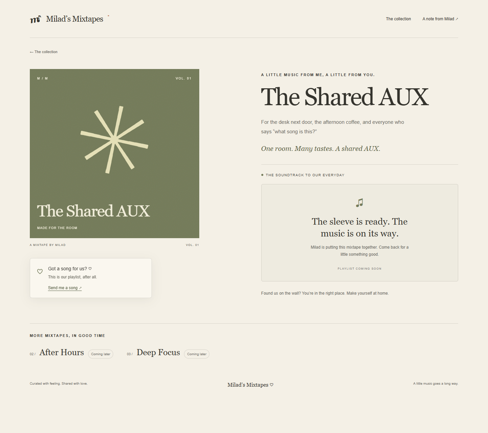
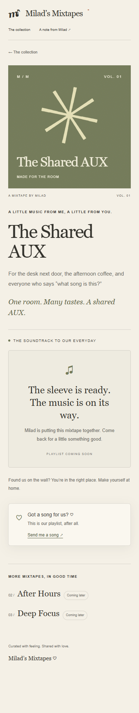

# The Shared AUX — first visual review

Status: **provisional implementation, awaiting visual approval**.

Read against `../PRODUCT.md`, `../DESIGN.md`, and `../../CODEX_START.md`.

## Scope

This change implements a dedicated `/music/office` route on the existing Next.js/TypeScript/Tailwind foundation. The other routes were already present in the base commit; their page designs have not been extended. Office cross-navigation is deliberately non-interactive upcoming-playlist text until visual approval. The shared suggestion component receives the specified copy, CTA, and the missing “Just for Milad” destination.

## Reference comparison

No approved screenshots are present in `docs/references/`; its README confirms they were not supplied. Pixel or visual differences cannot be measured against absent references. These captures are implementation proposals, not reference images.

| Aspect | Baseline / implementation proposal |
| --- | --- |
| Palette | Uses confirmed cream #F4F0E6, charcoal #34332D, olive #747B5A, terracotta #C58B70 tokens. Darker olive text is used for legibility. |
| Typography | Georgia headings with Arial body text; font families and sizes remain unapproved. Desktop hero scales up to 72px; mobile uses 52px. |
| Spacing and proportions | Two-column desktop sleeve/player layout with an 8% gutter; one-column layout at 600px and below. These dimensions are provisional. |
| Artwork | Existing abstract olive sleeve retained as a proposal, not approved artwork. |
| Suggestion card | Compact elevated card in the desktop sleeve rail, sticky within its column. On mobile it sits below the player in normal flow, avoiding any overlay on controls. This is a proposed interpretation of “floating” awaiting review. |
| Radius and shadows | Retained restrained corners and a soft card shadow; not approved reference values. |
| Responsive behavior | Mobile stacks artwork, introduction/player, suggestion card, then upcoming playlists. No fixed overlay obscures content. |

## Captures

Desktop viewport: 1440 × 1000, full-page capture.

Mobile viewport: 390 × 844, full-page capture.

## Behavior and validation

- Missing Spotify URL displays a coming-soon state. Configure `NEXT_PUBLIC_SPOTIFY_OFFICE_URL` in `mixtapes/.env.local`, using a public Spotify playlist URL; rebuild/restart after changing it.
- Configured player has a descriptive iframe title, responsive width, lazy loading, and a direct Spotify link if the embed is unavailable. Real playback remains unverified because no real URL was supplied.
- Suggestion dialog has labeled fields, office default destination, “Just for Milad,” optional name/private note, and disabled submission. No network submission, local persistence, or fake success.
- Native modal supports Escape and focus containment/restoration; visible focus and reduced-motion styling are inherited from the shared shell.
- `npm run lint`, `npx tsc --noEmit`, and `npm run build` pass.
- Browser review at desktop/mobile widths; checked narrow layouts at 320, 390, 768, and 1440px; checked dialog opening, selected destination, disabled submission, and Escape dismissal.
- URL configuration checks cover empty/invalid hosts and resource types, plus normalization of a synthetic embed URL. No real playlist ID was invented or configured.

## Review gate

Please review the desktop/mobile proposal and supply approved reference images (if available). Further route design work waits for visual approval as required by `AGENTS.md` and `CODEX_START.md`.
